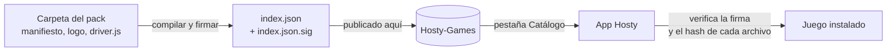

 

# Hosty-Games

**El catálogo de juegos firmado de [Hosty](https://github.com/Morphy137/Hosty).**
Todos los juegos que Hosty puede alojar, a un clic.

[English](README.md) · **Español**

---

## ¿Qué es esto?

[Hosty](https://github.com/Morphy137/Hosty) es una app de escritorio que crea y administra servidores dedicados de juegos en tu propio PC. No está atada a un solo juego: cada juego es un pequeño complemento llamado **pack de juego**.

**Hosty-Games es donde viven esos packs.** La app lee este repositorio, muestra lo disponible en su pestaña **Catálogo** e instala o actualiza un pack con un clic, sin terminal y sin copiar carpetas a mano.

## ¿Para qué sirve?

- **Instalar juegos desde Hosty** — abre *Packs de juegos → Catálogo* y pulsa **Instalar**.
- **Recibir actualizaciones sin una nueva versión de la app** — corregir un juego (versiones nuevas, un loader nuevo, un ajuste) solo requiere publicar una nueva versión del pack aquí.
- **Añadir soporte para juegos nuevos** — cualquiera puede crear un pack, así que Hosty no se limita a los juegos que su autor pueda mantener.
- **Mantenerte seguro** — todo lo de aquí se verifica antes de tocar tu computador (mira más abajo).

## ¿De dónde viene?

Al principio Hosty solo soportaba Minecraft y cada juego estaba escrito dentro de la app. Cuando llegaron más juegos eso dejó de escalar, así que la app se rehízo en torno a los packs:

1. **Los juegos pasaron a ser packs.** Un pack es una carpeta con un manifiesto `hosty-game.json` (cómo lanzar el servidor, sus archivos de configuración, qué pregunta la pantalla de creación) y, cuando el manifiesto no basta, un `driver.js` con código.
2. **La app incluye los tres de abajo** y los copia a su carpeta de juegos la primera vez que se abre.
3. **Este repositorio los publica como catálogo**, para poder actualizarlos y añadir juegos nuevos sin tocar la app.

¿Quieres los detalles del formato? Mira la [guía de packs de juegos](https://github.com/Morphy137/Hosty/blob/main/docs/game-packs.md).

## Packs disponibles

| | Juego | Estado | Versión |
| :---: | --- | --- | :---: |
|  | **Minecraft: Java Edition** Vanilla, Paper, Purpur, Fabric, Forge y NeoForge | Disponible | 1.0.0 |
|  | **Project Zomboid** Servidor dedicado con SteamCMD | Beta | 1.0.0 |
|  | **Hytale** Servidor dedicado (especificación y preview) | Próximamente | 1.0.0 |

## Cómo funciona

| Archivo | Qué es |
| --- | --- |
| `index.json` | Todos los packs: id, nombre, versión, autor, descripción y el SHA-256 y tamaño de cada archivo |
| `index.json.sig` | Firma Ed25519 de `index.json` |
| `packs/<id>/` | Los archivos de cada pack, tal como se instalan |
| `brand/` | Icono y banner de Hosty |

## Confianza y seguridad

Un pack puede incluir código (`driver.js`) que se ejecuta con los mismos permisos que Hosty, así que el catálogo es estricto:

- **Índice firmado.** Hosty solo acepta un `index.json` cuya firma verifica con la clave pública incluida en la app. Quien altere este repositorio no puede producir una firma válida.
- **Cada archivo se comprueba.** Antes de instalar, Hosty compara cada archivo descargado con el tamaño y el SHA-256 del índice firmado y descarta el pack si algo difiere.
- **Rutas confinadas.** Un pack solo puede escribir dentro de su propia carpeta.
- **Aquí nada se edita a mano.** `index.json` e `index.json.sig` los genera y firma el mantenedor, así que un cambio sin firma es ignorado por la app.

## Contribuir un pack

Las contribuciones son bienvenidas:

1. Crea tu pack siguiendo la [guía de packs de juegos](https://github.com/Morphy137/Hosty/blob/main/docs/game-packs.md) (`npm create hosty-game <id>` crea una base) y pruébalo en Hosty.
2. Abre un pull request que añada `packs/<tu-juego>/` con tu manifiesto, logo y, si hace falta, `driver.js`. Define `author` en el manifiesto para que tu nombre y enlace aparezcan en la app.
3. El mantenedor lo revisa, en especial cualquier `driver.js`, y lo publica regenerando y firmando el catálogo.

Los packs con código se revisan línea por línea antes de firmarse.

## Licencia

El catálogo y los packs publicados por Hosty están bajo la [PolyForm Noncommercial License 1.0.0](LICENSE): de uso libre para fines no comerciales, conservando el aviso de autoría en cualquier copia o versión modificada. Un pack de otro autor conserva la licencia que ese autor indique en su carpeta.

Hecho por <a href="https://github.com/Morphy137">Morphy137</a> para <a href="https://github.com/Morphy137/Hosty">Hosty</a>

