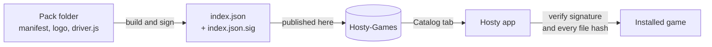

 

# Hosty-Games

**The signed game catalog of [Hosty](https://github.com/Morphy137/Hosty).**
Every game Hosty can host, one click away.

**English** · [Español](README.es.md)

---

## What is this?

[Hosty](https://github.com/Morphy137/Hosty) is a desktop app that creates and manages dedicated game servers on your own PC. It is not tied to a single game: each game is a small add-on called a **game pack**.

**Hosty-Games is where those packs live.** The app reads this repository, shows what is available in its **Catalog** tab and installs or updates a pack in one click, with no terminal and no copying folders by hand.

## What is it for?

- **Install games from inside Hosty** — open *Game packs → Catalog*, press **Install**.
- **Get updates without a new app release** — fixing a game (new versions, a new loader, a corrected setting) only needs a new pack version here.
- **Add support for new games** — anyone can build a pack, so Hosty is not limited to the games its author can maintain.
- **Stay safe** — everything here is verified before it touches your computer (see below).

## Where does it come from?

At the beginning Hosty only supported Minecraft, and each game was written into the app itself. As more games arrived, that stopped scaling, so the app was reworked around packs:

1. **Games became packs.** A pack is a folder with a `hosty-game.json` manifest (how to launch the server, its config files, what the setup screen asks) and, when the manifest is not enough, a `driver.js` with code.
2. **The app ships with the three below** and copies them to its games folder on first run.
3. **This repository publishes them as a catalog**, so they can be updated, and so new games can be added, without touching the app.

Want the details of the format? See the [game pack guide](https://github.com/Morphy137/Hosty/blob/main/docs/game-packs.md).

## Available packs

| | Game | Status | Version |
| :---: | --- | --- | :---: |
|  | **Minecraft: Java Edition** Vanilla, Paper, Purpur, Fabric, Forge and NeoForge | Available | 1.0.0 |
|  | **Project Zomboid** Dedicated server through SteamCMD | Beta | 1.0.0 |
|  | **Hytale** Dedicated server (engine spec and preview) | Coming soon | 1.0.0 |

## How it works

| File | What it is |
| --- | --- |
| `index.json` | Every pack: id, name, version, author, description and the SHA-256 and size of each file |
| `index.json.sig` | Ed25519 signature of `index.json` |
| `packs/<id>/` | The files of each pack, exactly as they get installed |
| `brand/` | Hosty icon and banner |

## Trust and safety

A game pack can include code (`driver.js`) that runs with the same permissions as Hosty, so the catalog is strict:

- **Signed index.** Hosty only accepts an `index.json` whose signature verifies against the public key built into the app. Someone who altered this repository cannot produce a valid signature.
- **Every file is checked.** Before installing, Hosty compares each downloaded file with the size and SHA-256 declared in the signed index and discards the pack if anything differs.
- **Confined paths.** A pack can only write inside its own folder.
- **Nothing is edited by hand here.** `index.json` and `index.json.sig` are generated and signed by the maintainer, so a change that is not signed is ignored by the app.

## Contributing a pack

Contributions are welcome:

1. Build your pack following the [game pack guide](https://github.com/Morphy137/Hosty/blob/main/docs/game-packs.md) (`npm create hosty-game <id>` creates a starter) and test it in Hosty.
2. Open a pull request that adds `packs/<your-game>/` with your manifest, logo and, if needed, `driver.js`. Set `author` in the manifest so your name and link show in the app.
3. The maintainer reviews it, in particular any `driver.js`, and publishes it by regenerating and signing the catalog.

Packs with code are reviewed line by line before they are signed.

## License

The catalog and the packs published by Hosty are under the [PolyForm Noncommercial License 1.0.0](LICENSE): free for noncommercial use, keeping the copyright notice in any copy or modified version. A pack by another author keeps the license that author states in its folder.

Made by <a href="https://github.com/Morphy137">Morphy137</a> for <a href="https://github.com/Morphy137/Hosty">Hosty</a>

